<div align="center">

# 📄 منصة إدارة وإنشاء العقود — تعاقد أجير

**نظام ويب عربي (RTL) لإدارة العقود وتصاريح العمل، يولّد مستند PDF مطابقاً للنموذج الرسمي حرفياً.**

[](https://ajeer-contracts-app.vercel.app)
[](https://supabase.com)
[](https://python.org)

</div>

---

## ✨ المزايا

| الميزة | الوصف |
|---|---|
| 🗂️ **إدارة كاملة للعقود** | إنشاء، عرض، تعديل، تكرار، حذف، بحث، تصفية حسب الحالة |
| 🖊️ **معاينة حيّة** | المستند يتحدّث أثناء الكتابة في النموذج |
| 📄 **PDF مطابق للنموذج** | 612×792pt، نفس الحدود والخطوط وأحجام النص وموضع رمز QR |
| 🔳 **رمز QR للتحقق** | رابط فريد عشوائي لكل تعاقد: `/agiar/index.php?id=<64 حرفاً>` — لا يكشف رقم التصريح ويعرض حالة التصريح وصلاحيته |
| 📊 **لوحة تحكم** | إحصاءات: إجمالي / سارية / تنتهي خلال 30 يوماً / منتهية |
| ☁️ **قاعدة بيانات سحابية** | Supabase (PostgreSQL) عبر PostgREST، مع احتياطي SQLite محلي |
| ⚡ **Serverless** | يعمل على Vercel Python Runtime بدون أي مكتبات نظام |
| 🔐 **نظام حسابات** | تسجيل دخول آمن (scrypt + جلسات SHA-256 لمدة 30 يوماً) |
| 👥 **إدارة مستخدمين** | إنشاء، تعديل، تعطيل، حذف، إعادة تعيين كلمة المرور، حماية حساب المالك |
| 🎛️ **20 صلاحية دقيقة** | عرض/إنشاء/تعديل/حذف للجميع أو لما أنشأه المستخدم فقط، صلاحيات المستخدمين، المراقبة، الإعدادات |
| 📊 **مصفوفة صلاحيات** | شاشة تعرض تغطية كل مستخدم لكل فئة صلاحيات |
| 🧾 **سجل نشاط (Audit)** | توثيق تلقائي لكل عملية: المنفّذ، العملية، العنصر، التفاصيل، مع تصفية وتصدير JSON |
| 📈 **حدود وصلاحية الحساب** | حد أقصى لعدد التعاقدات لكل مستخدم + تاريخ انتهاء صلاحية للحساب |

### 📸 لقطات من المنصة الحيّة

| لوحة التحكم | صفحة التعاقد |
|---|---|
| 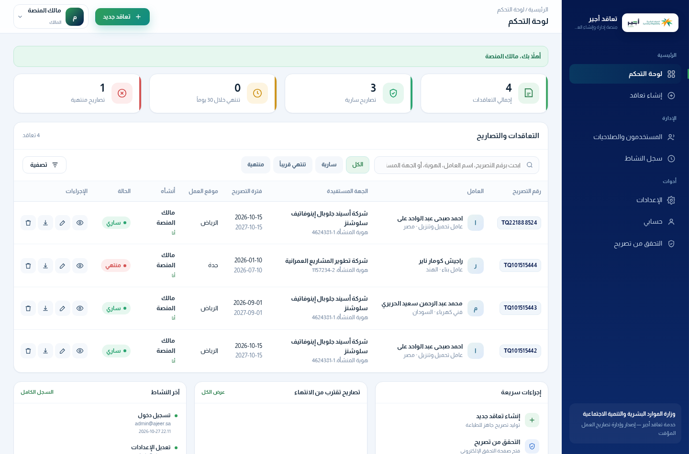 | 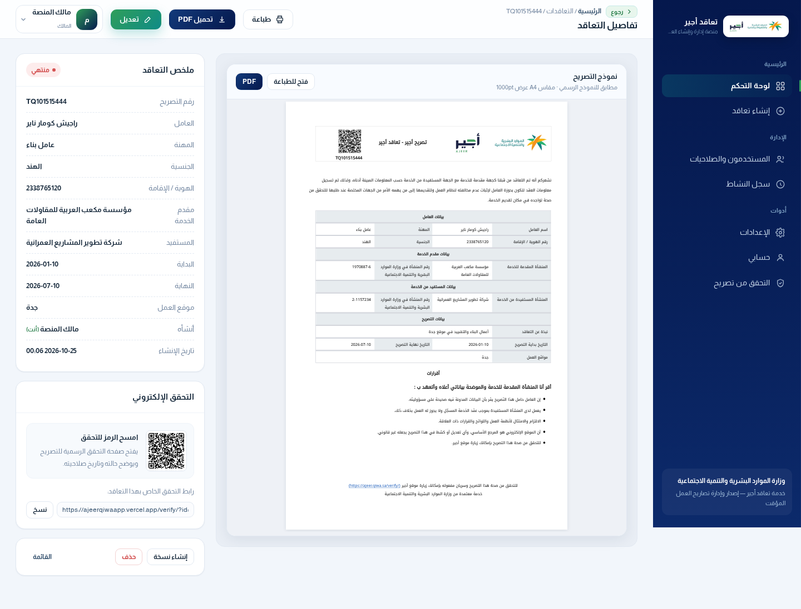 |

| إنشاء تعاقد + معاينة حيّة | المستند النهائي (PDF) |
|---|---|
| 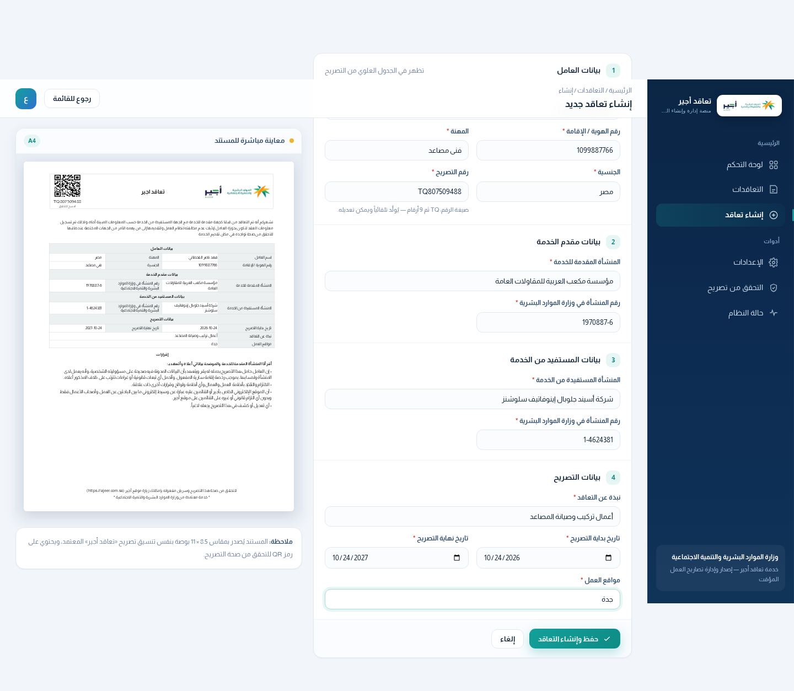 | 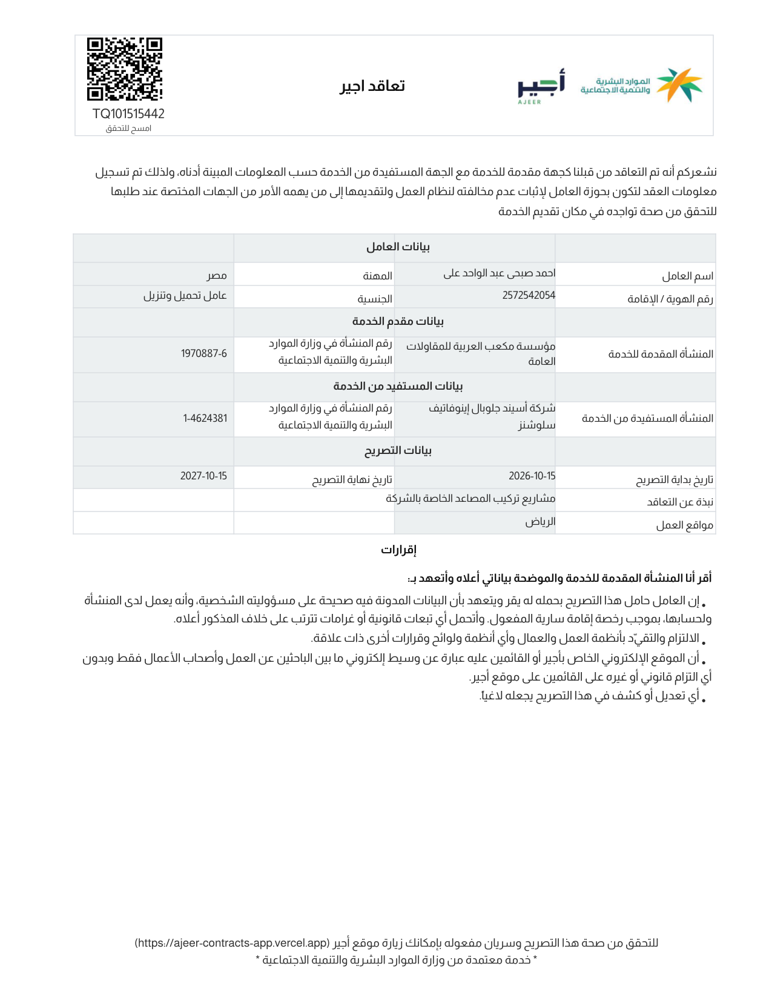 |

### 🛡️ لوحة الإدارة (نظام المستخدمين والصلاحيات)

| تسجيل الدخول | إدارة المستخدمين |
|---|---|
| 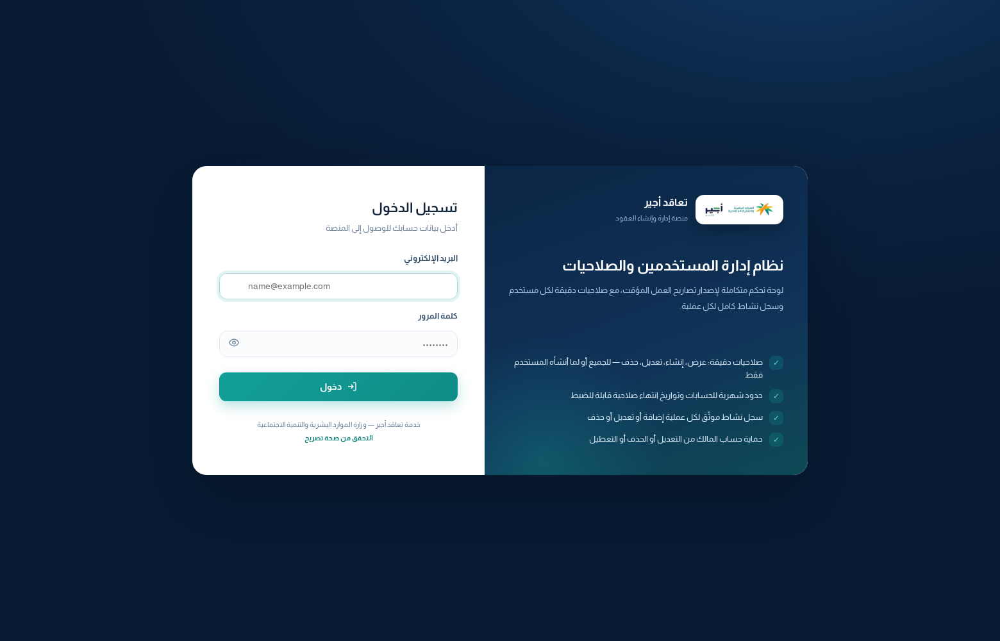 | 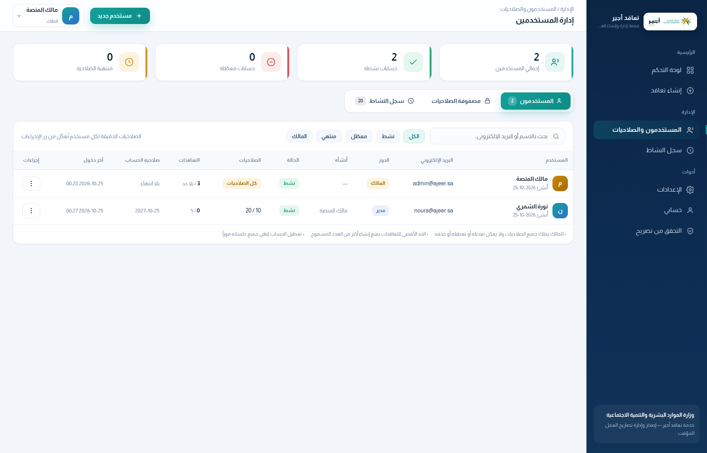 |

| إنشاء مستخدم + مصفوفة الصلاحيات | مصفوفة تغطية الصلاحيات |
|---|---|
| 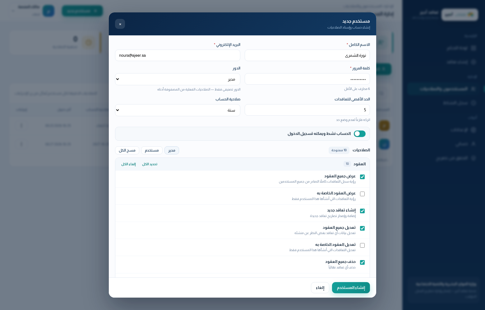 | 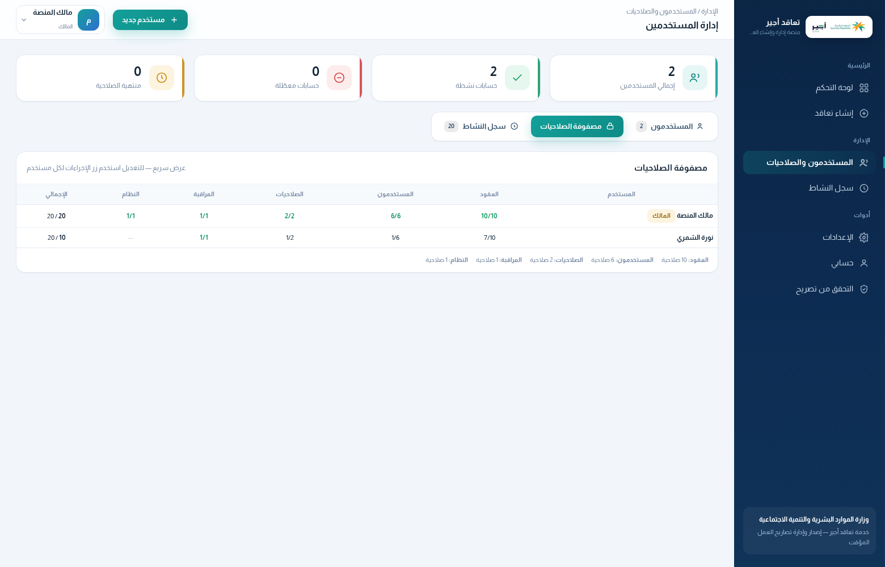 |

| سجل النشاط (Audit) | حسابي وكلمة المرور |
|---|---|
| 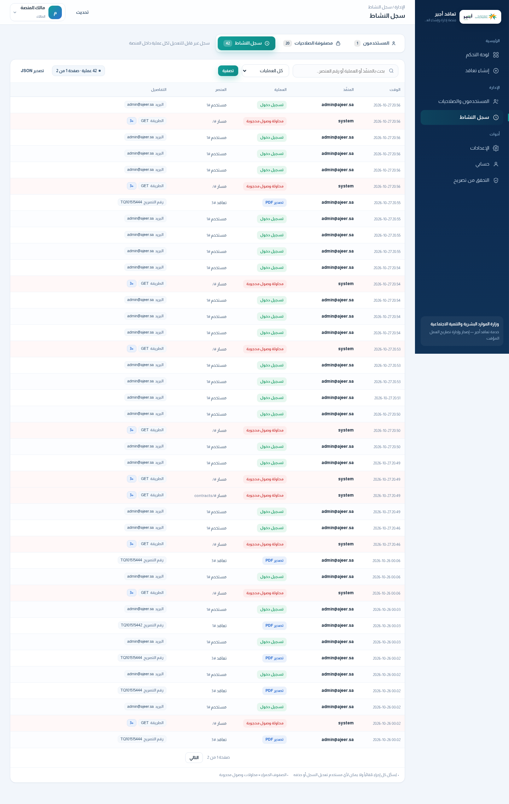 | 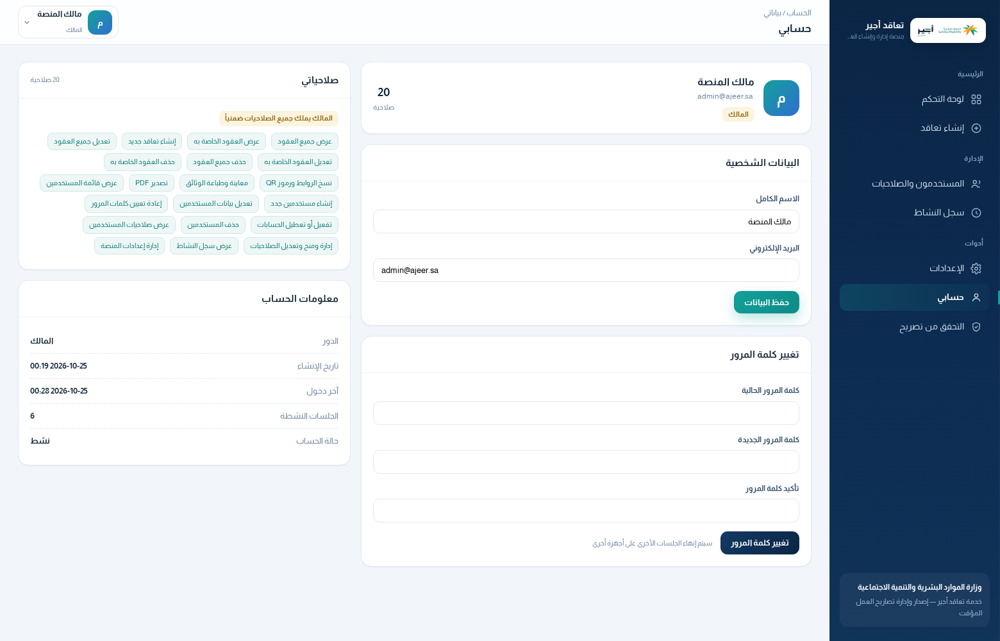 |

| صفحة التحقق التي يفتحها رمز QR |
|---|
| 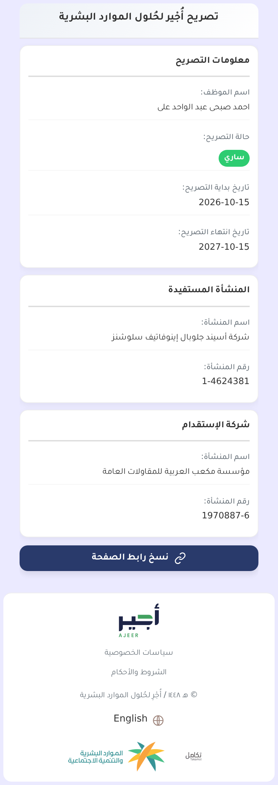 |

---

## 🧱 المعمارية

```
العميل (RTL/HTML/CSS/JS)
        │
        ▼
   Flask App  ──►  pdfdoc.py (fpdf2 + HarfBuzz)  ──►  PDF 612×792pt
        │
        ▼
   db.py  ──►  Supabase REST (PostgREST)  /  SQLite (تطوير)
```

```
ajeer-contracts/
├── api/index.py            # نقطة دخول Vercel
├── vercel.json             # إعدادات النشر
├── requirements.txt
├── backend/
│   ├── app.py              # مسارات Flask
│   ├── db.py               # طبقة البيانات (Supabase / SQLite)
│   ├── pdfdoc.py           # مُولّد المستند (إحداثيات مقيسة من النموذج)
│   ├── templates/          # قوالب Jinja2 (RTL)
│   └── static/             # CSS + خطوط Almarai + الشعار
└── scripts/
```

---

## 🌐 الروابط الحيّة

| الوجهة | الرابط |
|---|---|
| 🏠 **المنصة** | **https://ajeer-contracts-app.vercel.app** |
| 🔐 لوحة التحكم | https://ajeer-contracts-app.vercel.app/ |
| ➕ إنشاء تعاقد | https://ajeer-contracts-app.vercel.app/contracts/new |
| 📄 مستند PDF | https://ajeer-contracts-app.vercel.app/contracts/1/pdf |
| ✅ التحقق (QR) | https://ajeer-contracts-app.vercel.app/verify/TQ101515442 |
| ❤️ حالة النظام | https://ajeer-contracts-app.vercel.app/api/health |
| 💻 الكود المصدري | https://github.com/elias0878/ajeer-contracts |

---

## 🚀 التشغيل المحلي

```bash
# 1) المكتبات
pip install -r requirements.txt

# 2) (اختياري) متغيرات البيئة للاتصال بـ Supabase
export SUPABASE_URL="https://<ref>.supabase.co"
export SUPABASE_SERVICE_KEY="<service_role_key>"

# 3) التشغيل
cd backend && python app.py     # http://localhost:5000
```

بدون متغيرات البيئة يعمل التطبيق تلقائياً على **SQLite** محلي مع بيانات تجريبية.

---

## 🔌 واجهات API

| المسار | الوصف |
|---|---|
| `GET /` | لوحة التحكم |
| `GET /contracts/new` · `POST` | إنشاء تعاقد |
| `GET /contracts/<id>` | تفاصيل التعاقد |
| `GET /contracts/<id>/edit` · `POST` | تعديل |
| `POST /contracts/<id>/delete` | حذف |
| `POST /contracts/<id>/duplicate` | تكرار |
| `GET /contracts/<id>/pdf` | تحميل PDF |
| `GET /contracts/<id>/print` | صفحة طباعة |
| `POST /contracts/preview` | معاينة حيّة (HTML) |
| `GET /agiar/index.php?id=<token>` | صفحة التحقق العامة التي يفتحها رمز QR |
| `GET /verify/<token أو رقم التصريح>` | توافق خلفي مع الروابط القديمة |
| `GET /api/qr/<permit_no>.png` | صورة QR |
| `GET /api/health` | حالة النظام والقاعدة 🔒 (للمسجّلين) |
| `GET /login` · `POST` | تسجيل الدخول |
| `GET /logout` | تسجيل الخروج وإنهاء الجلسة |
| `GET /account` · `POST` | حسابي: تعديل البيانات / كلمة المرور |
| `GET /admin?tab=users\|perms\|audit` | لوحة الإدارة (مستخدمون / مصفوفة / سجل) |
| `GET /api/admin/users` · `POST` | قائمة المستخدمين / إنشاء مستخدم |
| `PATCH\|DELETE /api/admin/users/<id>` | تعديل بيانات وصلاحيات / حذف مستخدم |
| `POST /api/admin/users/<id>/reset-password` | إعادة تعيين كلمة المرور |
| `POST /api/admin/users/<id>/toggle-active` | تفعيل/تعطيل الحساب |
| `POST /api/admin/users/<id>/contracts/revoke\|delete` | إلغاء أو حذف كل تعاقدات المستخدم |
| `GET /api/admin/audit` | سجل النشاط (JSON) |
| `GET /api/me` | بيانات المستخدم الحالي وصلاحياته |

---

## 📐 دقة المستند

تم استخراج إحداثيات النموذج الرسمي من ملف PDF مرجعي ثم ضبطها رقمياً:

| العنصر | القيمة |
|---|---|
| مقاس الصفحة | 612 × 792 pt (Letter) |
| الترويسة | (59.5, 27.8) → 506 × 79.6 pt |
| رمز QR | (69.5, 29.9) — 59.1 × 49.5 pt |
| الشعار | (406, 50) — 157 × 36 pt |
| الجدول | 5 حدود رأسية متساوية بدءاً من x=58.1 |
| الخط | Almarai (Regular/Bold) |

> الفرق المتوسط في مواضع النصوص عن النموذج الأصلي: **< 1.5 pt**.

---

## 🔐 نظام الحسابات والصلاحيات

مبني على نموذج لوحة **بلدي**: مستخدمون + صلاحيات دقيقة + جلسات موثّقة + سجل نشاط.

### أول دخول

| الحساب | القيمة |
|---|---|
| البريد | `admin@ajeer.sa` |
| كلمة المرور | `Ajeer@2026` |
| الدور | `owner` (المالك) |

> ⚠️ **غيّر كلمة المرور فوراً** من صفحة **حسابي**، ويمكنك أيضاً تغيير البريد الإلكتروني.
> المالك يملك كل الصلاحيات ضمنياً، ولا يمكن تعديله أو تعطيله أو حذفه من لوحة الإدارة.

### الصلاحيات (20)

| الفئة | الصلاحيات |
|---|---|
| العقود | `view_all` `view_own` `create` `edit_all` `edit_own` `delete_all` `delete_own` `links` `print` `export` |
| المستخدمون | `view` `create` `edit` `reset_password` `activate` `delete` |
| الصلاحيات | `view` `manage` |
| المراقبة | `audit.view` |
| النظام | `settings.manage` |

### قواعد الحماية المطبَّقة

| القاعدة | التفصيل |
|---|---|
| 🔒 حماية المالك | لا يُعدَّل ولا يُعطَّل ولا يُحذف؛ يغيّر بياناته من «حسابي» فقط |
| 🚫 منع تصعيد الصلاحيات | غير المالك لا يمنح صلاحية لا يملكها هو نفسه |
| 🧍 عزل العقود | `*_own` يقيّد الرؤية/التعديل/الحذف على ما أنشأه المستخدم (`created_by`) |
| 📈 حدود التعاقدات | `contract_limit` يمنع الإنشاء عند بلوغ الحد (فارغ = بلا حد) |
| ⏳ انتهاء الحساب | `expires_at` يمنع الدخول تلقائياً بعد التاريخ |
| 🚪 إنهاء الجلسات | تعطيل الحساب أو تغيير كلمة المرور يُلغي كل الجلسات فوراً |
| 🧾 سجل غير قابل للتعديل | كل عملية تُسجَّل تلقائياً (تسجيل-أفضل-جهد لا يُفشل العملية) |

### رابط التحقق ورمز QR

كل تعاقد يحصل على **رمز تحقق عشوائي غير قابل للتخمين** (64 محرفاً base64url، 48 بايت عشوائية):

```
{verify_domain}{verify_path}?id={verify_token}
مثال: https://<your-domain>/agiar/index.php?id=CJ7hS5Jvq-pt2ViQAy0aN_IBV4G9aD5fnb-aXD14xD5MiqFWO1DBkeT2mmLVD-yL
```

| الإعداد | القيمة الافتراضية | الوصف |
|---|---|---|
| `verify_domain` | نطاق التطبيق الحالي | يمكن تغييره من صفحة الإعدادات |
| `verify_path` | `/agiar/index.php` | مسار صفحة التحقق |
| `verify_token` | عشوائي لكل تعاقد | عمود في جدول `contracts`، فريد |

**خصائص الأمان:** الرابط لا يحتوي رقم التصريح · لا يمكن تخمينه (48 بايت عشوائية) · رمز خاطئ يعيد `404` ·
الروابط القديمة `/verify/<permit_no>` ما زالت تعمل للتوافق.

> **ملاحظة إلزامية:** لكي يفتح رمز QR على نطاقك الخاص، يجب توجيه ذلك النطاق إلى هذا التطبيق
> (DNS: `CNAME` إلى `cname.vercel-dns.com` أو `A` إلى `76.76.21.21`) ثم تغيير `verify_domain`
> من صفحة الإعدادات. طالما النطاق يشير إلى سيرفر آخر فلن يتعرّف على رموز هذا التطبيق.

### التقنية

| العنصر | التفصيل |
|---|---|
| كلمات المرور | `scrypt` (N=16384, r=8, p=1) بصيغة `s2:<salt>:<hash>` ومقارنة زمنية ثابتة |
| الجلسات | توكن عشوائي 32 بايت، يُخزَّن **هاش SHA-256 فقط**، صلاحية 30 يوماً، `HttpOnly` + `SameSite=Lax` + `Secure` |
| الجداول | `app_users`, `app_sessions`, `app_permissions`, `app_audit_log` |
| RLS | مفعّل على كل جداول الحسابات — الوصول عبر `service_role` من الخادم فقط |
| الملف | `supabase/schema.sql` (جاهز للتنفيذ في SQL Editor) |

---

## 🔐 متغيرات البيئة على Vercel

| المتغير | الوصف |
|---|---|
| `SUPABASE_URL` | `https://<ref>.supabase.co` |
| `SUPABASE_SERVICE_KEY` | مفتاح service_role (سري) |
| `SECRET_KEY` | مفتاح تشفير جلسات Flask |
| `PUBLIC_BASE_URL` | `https://ajeer-contracts-app.vercel.app` |
| `OWNER_EMAIL` | (اختياري) بريد المالك الأول — يُستخدم فقط عند التهيئة الأولى |
| `OWNER_PASSWORD` | (اختياري) كلمة مرور المالك الأول — يُستخدم فقط عند التهيئة الأولى |

---

## 📜 الترخيص

MIT © 2026


---

## 🗄️ مخطط قاعدة البيانات (Supabase)

```sql
create table public.contracts (
    id                bigint generated by default as identity primary key,
    permit_no         text not null unique,
    worker_name       text not null,
    id_no             text not null,
    profession        text not null,
    nationality       text not null,
    provider_name     text not null,
    provider_no       text not null,
    beneficiary_name  text not null,
    beneficiary_no    text not null,
    description       text not null,
    start_date        date not null,
    end_date          date not null,
    site              text not null,
    created_at        timestamptz not null default now(),
    updated_at        timestamptz not null default now(),
    created_by        bigint,          -- منشئ التعاقد (لعزل *_own)
    created_by_name   text,
    created_by_email  text
);

create table public.settings (key text primary key, value text);

-- نظام الحسابات والصلاحيات
create table public.app_users (
    id bigint generated by default as identity primary key,
    email text not null unique,
    password_hash text not null,        -- s2:<salt>:<scrypt-hash>
    full_name text not null,
    role text not null default 'user' check (role in ('owner','admin','user')),
    is_active boolean not null default true,
    created_by bigint references public.app_users(id) on delete set null,
    created_at timestamptz not null default now(),
    updated_at timestamptz not null default now(),
    last_login_at timestamptz,
    contract_limit integer,             -- null = بلا حد
    expires_at timestamptz              -- null = لا تنتهي
);

create table public.app_sessions (
    id bigint generated by default as identity primary key,
    user_id bigint not null references public.app_users(id) on delete cascade,
    token_hash text not null unique,    -- SHA-256 فقط
    expires_at timestamptz not null,
    user_agent text, ip text,
    created_at timestamptz not null default now(),
    last_seen_at timestamptz not null default now()
);

create table public.app_permissions (
    id bigint generated by default as identity primary key,
    user_id bigint not null references public.app_users(id) on delete cascade,
    permission text not null, granted boolean not null default true,
    updated_at timestamptz not null default now(),
    unique (user_id, permission)
);

create table public.app_audit_log (
    id bigint generated by default as identity primary key,
    actor_id bigint, actor_email text not null default 'system',
    action text not null, entity text not null default '',
    entity_id text not null default '', details jsonb not null default '{}'::jsonb,
    created_at timestamptz not null default now()
);
```

مُفعَّل على كل الجداول **Row Level Security** مع سياسة `service_role` فقط —
لا يمكن الوصول للبيانات بأي مفتاح عام (anon).

> الملف الكامل الجاهز للتنفيذ: `supabase/schema.sql`

---

## 🛡️ نموذج الأمان: لا شيء عام إلا رابط التحقق

بوابة حجب مركزية (`before_request`) تُطبَّق على **كل** الطلبات قبل أي معالجة:

| المسار | الوصول |
|---|---|
| `/agiar/index.php?id=<token>` · `/verify/<token>` | 🌍 **عام** — صفحة التحقق فقط |
| `/login` · `/logout` | 🌍 عام (ضروري لتسجيل الدخول) |
| `/static/...` · `/robots.txt` · `/favicon.ico` | 🌍 عام (ملفات عرض فقط) |
| `/` · `/contracts/*` · `/settings` · `/account` · `/admin` | 🔒 **جلسة صحيحة إلزامية** |
| `/api/*` (بما فيها `/api/health` و`/api/qr/*`) | 🔒 **401** لغير المسجّلين |
| **أي مسار آخر غير معروف** (`/wp-admin`, `/.env`, `/random` …) | 🚫 **لا يُكشف وجوده** — تحويل إلى الدخول |

### إجراءات الحماية المطبَّقة

| الحماية | التفصيل |
|---|---|
| 🚪 حجب المسارات غير المعروفة | تُعاد كأنها غير موجودة — لا نكشف بنية التطبيق للماسحات |
| 🔑 صفحة التحقق | برمز عشوائي 64 محرفاً فقط — **لا يمكن تعداد أرقام التصاريح من الخارج** (البحث برقم التصريح للمسجّلين فقط) |
| 🧨 حماية من التخمين | حجب مؤقت (15 دقيقة) بعد 8 محاولات فاشلة لنفس البريد أو 12 لنفس الـ IP — مع تسجيل المحاولات |
| 🕵️ سجل محاولات الوصول | كل محاولة وصول محجوبة تُسجَّل (`security.denied`) مع الـ IP، مرة واحدة لكل عنوان/10 دقائق |
| 🔗 منع التحويل المفتوح | معامل `?next=` يُقبل فقط كمسار داخلي (يُرفض `//evil.com`) |
| 🧾 ترويسات أمان | CSP · `X-Frame-Options` · `X-Content-Type-Options` · `Referrer-Policy` · `Permissions-Policy` · HSTS · `X-Robots-Tag: noindex` · `Cache-Control: no-store` |
| 🤖 عدم الفهرسة | `robots.txt: Disallow: /` + `noindex` على كل الصفحات |
| 🖼️ رمز QR | يُبنى من رابط التحقق الرسمي فقط (لا معامل `target` خارجي) |
| ⚡ جلسات | `HttpOnly` + `Secure` + `SameSite=Lax`، توكن 32 بايت يُخزَّن كـ SHA-256، إنهاء فوري عند تعطيل الحساب |

> `/api/health` أصبح **للمسجّلين فقط**. لمراقبة التشغيل استخدم حساباً أو أضف نقطة فحص خاصة بك.

---

## ✅ الاختبارات

```bash
python scripts/smoke_test.py     # 62 اختباراً — كلها ناجحة
```

يشمل: المصادقة، حماية المسارات، عزل العقود (`*_own`)، منع تصعيد الصلاحيات،
تعطيل/تفعيل الحسابات، حذف المستخدم، حماية المالك، سجل النشاط، توليد PDF.
